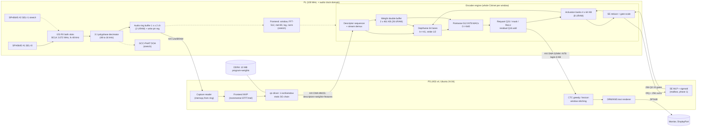

# Architecture review: live speech-to-text on the Kria KV260

Reviewed 2026-10-11 against the Prototype v2 source snapshot of that date. Decisions are logged in [DECISIONS.md](DECISIONS.md), and the plan is in [ROADMAP.md](ROADMAP.md).

**Evidence tags.** Every number carries one of these tags:
- **[M]** measured, with the file and line or report it came from;
- **[C]** computed, either with the formula shown or by [`analysis/`](analysis/README.md);
- **[E]** estimated, with the assumptions stated;
- **[UNVERIFIED]** could not be checked from the files or a cited source.

Nothing here was run on the board or in Vivado.

---

## 0. Bottom line

1. **Keep open-vocabulary English and keep Citrinet-256-LS.** Change the PS/PL split from "32 depthwise/pointwise pairs, one ioctl each" to "the whole encoder per audio window on the PL, fed by one DMA chain".
   - **Why the current split has to change:** it is capped by Amdahl's law. Even with an infinitely fast PL, the work that stays on the CPU (83.6 ms) limits the 1 s gain to **20.5 %** **[C from M]**.
   - **What the recommended split gives:** PL time drops to roughly 15–36 ms per 2.56 s window, against 148–170 ms today **[E]**. That makes a 250 ms hop affordable, and with it about 0.5 s text latency **[C]**.
2. **The microphone is run outside its datasheet.**
   - The BCLK is 1.024 MHz. The datasheet minimum is 2.048 MHz, and the mic's sleep threshold is 0.9 MHz.
   - The 100 MHz NCO adds 2.89 ns RMS edge jitter, against a 2 ns limit **[C]**.
   - Capture-under-inference has never been tested. The receive FIFO holds only 64 ms of audio, while a single inference occupies all four cores for 92–170 ms **[M]**.
   - **Fix:** capture at 48 kHz and decimate 3:1 in the PL. This is a real PL DSP block that the hardware requires.
3. **Use one microphone for ASR.** At realistic spacings, a second mic gives only 0.3–2.8 dB of delay-and-sum gain in diffuse noise **[C]**. Capturing both I2S slots costs almost nothing, so add the second mic only as a direction-of-arrival stretch goal.
4. **Drive the display through DRM/KMS** from the PS, with GNOME turned off. That costs under 1 % of one core **[E]**. Overlaying text from the PL through DisplayPort live video is a stretch goal.
5. **Biggest risk:** Citrinet is not causal, so accuracy with short right context is unmeasured. Running that measurement is the first gating task, and it can be done offline on the Mac.

---

## 1. Fact-check of the brief

| Claim in the brief | Verdict | Evidence |
|---|---|---|
| Citrinet-256-LS, ~9.8 M params, 80-bin log-mel, 23 SE blocks, WordPiece CTC with 257 classes, non-causal | **Correct** | 9,767,441 trainable params **[M]** `research/README.md`. The config has 23 jasper entries, all `se: true`, `se_context_size: -1` (global), and `normalize: per_feature` **[M]** `research/checkpoints/citrinet-256-ls/model_config.yaml:26,33`. My parser counts 107 depthwise, 129 pointwise and 23 SE layers, matching the snapshot census exactly **[C]**. |
| "A custom execution provider" offloads the pairs | **Wrong** | It is an ORT **custom operator**, `FpgaDepthwisePointwise`, in domain `prototype.fpga.shortcache`, registered on `CPUExecutionProvider` **[M]** `software/ort_fpga_shortwide/pointwise.cc:139-168`. ORT never sees an accelerator, only a CPU kernel that calls ioctls. |
| 32 resident depthwise/pointwise pairs over DMA through `qn_tile` | **Correct**, with detail | 32 pairs, all in blocks 1–8 **[M]** `software/ort_fpga_shortwide/selection.json`. The driver copies each payload in and out of bounce buffers (`copy_from_user`/`copy_to_user`) **[M]** `deployment/experimental-shortwide/qn_tile.c:198,327`. |
| Frontend, SE, masks and decoding on the PS | **Mostly correct** | Masking and requantisation *between* each pair's depthwise and pointwise layers run on the PL. Activation, residual and SE run on the CPU **[M]** `RESULTS.md`. |
| Shortwide is 10–13 % faster, up to 256 frames, 20 % target not met | **Correct** | 9.86 % at 0.5 s and 11.99 % at 1 s (300 paired runs) **[M]** `RESULTS.md`. 12.3–12.9 % at 1.5–2.55 s (100 pairs) **[M]** `RESULTS.md`. The project's interim 10 % gate also failed at 0.5 s. |
| PL active 8.3 ms of ~464 ms | **Correct, but for the older image** | That is the six-operator 512-MAC image **[M]** `RESULTS.md`. On shortwide the PL is active 6.08 ms of 92.6 ms at 1 s, i.e. **6.6 %**, and 4.05 of 62.4 ms at 0.5 s, i.e. 6.5 % **[M]** `reports/fused/shortwide_counter_comparison.json`. |
| Utilisation LUT 66.8 %, BRAM 75.4 %, URAM 100 %, DSP 69.4 %, WNS +0.055 ns; 1,024-MAC variant failed routing | **Correct** | **[M]** `reports/fused/short_wide_system_utilization.rpt` and `short_wide_system_timing.rpt`. FFs are 11.9 %. The 1,024-MAC failure was 1,288 node overlaps **[M]** `RESULTS.md`. |
| Capture deferred, no DisplayPort | **Correct** | `capture_tested: false` **[M]** `reports/fused/shortwide_scheduled_summary.json`. The overlay's PS has `PSU__DISPLAYPORT__PERIPHERAL__ENABLE = 0` and `PSU__USE__VIDEO = 0` **[M]** `Prototype_v2.srcs/.../asr_v2_system_ps_0.xci`. |
| Mic receiver: 16 kHz, SELECT grounded, left slot only; WS B10, BCLK D11, DATA E12 | **Correct, and it hides a defect** | **[M]** `rtl/sph0645_rx.v:2-4`, `hardware/pmod.xdc:14,16,18`. A 1.024 MHz BCLK is **below the datasheet's 2.048 MHz minimum** (Knowles SPH0645LM4H-B: f_CLOCK 2048/3072/4096 kHz min/typ/max, sleep below 900 kHz) **[M]** ([datasheet](https://cdn-shop.adafruit.com/product-files/3421/i2S+Datasheet.PDF); Adafruit: "should run at 2-4 MHz", [pinouts](https://learn.adafruit.com/adafruit-i2s-mems-microphone-breakout/pinouts)). |
| Toolchain mismatch | **Correct, and wider than stated** | The snapshot's board runs **Ubuntu 24.04, Python 3.12**, kernel 6.8.0-1015-xilinx **[M]** `deployment/README.md`. See §5.4. |

---

## 2. Model selection (Q1)

### 2.1 Candidates

The on-chip budget is 64 URAM (2,359,296 B) plus 144 BRAM36 (663,552 B), **3.02 MB** in total **[C]**. For the open-vocabulary models, "MACs/s" means a single pass. Buffered streaming multiplies it by window/hop. For Citrinet with a 2.56 s window and 0.25 s hop that is ×10.24, or **2.78 GMAC/s** **[C]**.

| Candidate | Accuracy evidence | Can it stream? | Operator mix and fit to the DSP MAC array | INT8 weights vs 3.02 MB on chip | MACs per s of audio | DDR bandwidth for real time | Effort this term |
|---|---|---|---|---|---|---|---|
| **Citrinet-256-LS** (baseline, NeMo) | LibriSpeech test-clean/other 3.78/9.60 % WER (model-card eval metadata) **[M]** `research/README.md`. On the board: 24/269 word errors on 9 diagnostic clips, identical CPU vs FPGA **[M]** | **No.** Global SE and symmetric kernels. Buffered windows only (§2.3) | 1-D depthwise + pointwise conv, ReLU, BN folded, residual adds, 23 global SE. **94.1 % of conv MACs are pointwise** **[C/M]**, which suits a MAC array. The 64-lane depthwise and 512-MAC pointwise engines already exist and are validated on hardware | 9.74 MB = **3.2× on-chip** **[C]**. The largest block is 461 KB and the largest layer 165 KB, so weights stream per block with double buffering | **271 M** **[C]** | 9.74 MB per window **[C]**: 19.5 MB/s at a 0.5 s hop, 39 MB/s at 0.25 s. HP0 is 128-bit at 100 MHz, 1.6 GB/s peak **[C]** from the xci | **Lowest.** Export, integer oracle, RTL primitives, driver and runtime all exist |
| **QuartzNet 5x5** (NeMo, LibriSpeech) | dev-clean/other **5.39/15.69 %** greedy **[M]** ([Kriman et al., Table 2](https://arxiv.org/abs/1910.10261)). 15x5: test 3.90/11.28 | **Partly.** No global SE, but symmetric kernels up to k = 87, so it still needs buffered windows. Less context penalty because there are no global statistics **[E]** | Same operator family as Citrinet minus SE. Needs a depthwise engine with k ≤ 87 and 512/1024-channel pointwise layers | 6.69 MB = 2.2× **[C]** (paper: 6.7 M). Largest layer 524 KB | **334 M** **[C]**. Stride 2 only, against Citrinet's 8 | 6.69 MB per window | Medium: new export, calibration, oracle and kernel support. **Worse WER than Citrinet at higher MAC cost**, and its own CPU baseline also changes |
| **Streaming Zipformer-20M** transducer (sherpa-onnx `streaming-zipformer-en-20M-2023-02-17`) | No WER published on the model page **[UNVERIFIED]** ([k2-fsa](https://k2-fsa.github.io/sherpa/onnx/pretrained_models/online-transducer/zipformer-transducer-models.html)) | **Yes**, natively (chunked, cached) | Multi-head attention with softmax, BiasNorm, Swoosh activations, conv modules, multi-rate downsampling, plus a transducer decoder/joiner with beam search. **Poor fit:** it needs softmax and normalisation units and a stateful cache protocol that don't exist | fp32 encoder file is 85 MB, so about **21 M params ≈ 21 MB INT8 = 7×** **[E]** (85 MB/4 B). The int8 file is 41 MB (partial quantisation) **[M]** | [UNVERIFIED] | about 21 MB per chunk pass **[E]** | **Very high.** New RTL operator families; nothing reusable |
| **DS-CNN-L keyword spotting** (Hello Edge) | **95.4 %** on Speech Commands (12 classes). DS-CNN-S: 94.4 % with 38.6 KB **[M]** ([Zhang et al., Table 7](https://arxiv.org/abs/1711.07128)) | **Yes** (sliding 1 s window) | 2-D conv, 2-D depthwise 3×3, pointwise. Good fit, and small | **497.6 KB = 0.16×. Fits entirely on chip** **[M]** | 56.9 M ops per 1 s inference **[M]**. ×10 at a 100 ms hop | 0 (resident) | Low RTL effort, but needs MFCC frontend changes and a trained model. **Doesn't meet "voice to text"** |

### 2.2 Decision: open-vocabulary English with Citrinet-256 (D-02, D-03)

- **What keyword spotting would buy:** 100 % on-chip residency, true streaming, and a design that is easy to verify.
- **What it would cost:** the product. A 10–12-word recogniser is a different, much weaker demo. The industry assessors would see a 2017 microcontroller benchmark, not live transcription.
- **What open vocabulary already has:** it runs on this hardware, with numerically exact PL/CPU parity.
- **Why the other two models lose:**
  - QuartzNet 5x5 is less accurate (dev-other 15.69 vs Citrinet test-other 9.60) and needs more MACs (334 vs 271 M/s).
  - Zipformer is the only model that truly streams, but almost none of its arithmetic maps onto the engine that exists.
- **If command-level accuracy is needed later:** constrain the CTC decoder on the PS (lexicon or prefix beam search with a word list). This doesn't touch the PL design (D-21).

### 2.3 How a non-causal model runs live (D-04)

Run Citrinet on a sliding window of W = 2.56 s. That is the 256-frame hardware maximum, `fused_depthwise_channel_wide.sv:5` `MAX_T=256` **[M]**.
- Advance the window by a hop H.
- Emit only the tokens whose CTC frames fall in a stable region at least R seconds before the window's end.

This is NeMo's buffered CTC inference. Its defaults are a 1.6 s chunk in a 4.0 s buffer, which puts 1.2 s of context on each side **[M]** ([NeMo script](https://www.huggingface.co/spaces/smajumdar/nemo_multilingual_language_id/blob/main/speech_to_text_buffered_infer_ctc.py), [docs](https://docs.nvidia.com/nemo/speech/latest/asr/inference.html)). Citrinet's output stride is 8 frames = 80 ms **[C]**, consistent with NeMo's Citrinet `model_stride=8` ([PR #9367](https://github.com/NVIDIA/NeMo/pull/9367/files)).

Two effects are unmeasured:
- How WER degrades with right context R ∈ {0, 0.25, 0.5, 1.0} s.
- Whether per-window SE and feature normalisation hurt compared with a running normalisation.

The snapshot's 0.25/0.5/1 s prefix tests check only CPU/FPGA parity, not accuracy **[M]** `RESULTS.md`. This is the top risk, and ROADMAP task 2 measures it.

### 2.4 Latency target (D-05)

Latency from the end of a word to pixels on screen ≈ H/2 (mean wait for the hop) + R + C (compute per window) + D (one 60 Hz frame, 17 ms) **[C]** `analysis/estimates.py §7`:

| Operating point | Mean | Worst |
|---|---|---|
| H = 0.5, R = 1.03 (symmetric context), C = 148 ms (shortwide today) | 1.44 s | 1.69 s |
| H = 0.25, R = 0.25, C = 148 ms (shortwide today) | 0.54 s | 0.67 s |
| **H = 0.25, R = 0.25, C = 40 ms (whole-encoder PL)** | **0.43 s** | **0.56 s** |
| H = 0.25, R = 0.5, C = 40 ms | 0.68 s | 0.81 s |

**Target:**
- Final (stable) text appears with mean ≤ 0.5 s and p95 ≤ 0.8 s after the word ends.
- Provisional text from the newest window appears within ≤ 0.35 s.
- No samples are dropped over 30 minutes.
- The PS keeps ≥ 50 % of one core idle.

**Why this target:**
- Your 500 ms assumption is reachable only with H = 0.25 s and R ≤ 0.25 s.
- At that hop, CPU-only inference would take **68 %** of all four cores (169.5 ms per 250 ms) **[C from M]**, and shortwide **59 %** **[C from M]**. That leaves no margin for capture and display, which is exactly where live systems drop audio.
- The whole-encoder PL brings duty down to about 10 % **[E]**.

So the live target is the honest engineering reason the PL has to do the inference.

---

## 3. PS/PL partition and interface (Q2)

### 3.1 Amdahl bounds from the measured profile

Measured shortwide medians (64 lanes) at a 1 s context **[M]** `reports/fused/shortwide_counter_comparison.json`:

| Component | Time |
|---|---|
| Frontend | 6.09 ms |
| Model | 86.28 ms |
| └ ioctls (part of model) | 7.99 ms |
| └ model outside transport (part of model) | 77.39 ms |
| Decode | 0.15 ms |
| PL active | 6.08 ms (608,096 cycles) |
| Input-stall cycles | 260,576 (43 % of active) |
| CPU p50 / FPGA p50 | 105.25 / 92.63 ms |

| Partition option | Share of model MACs on the PL | Share of time the PL is busy | Ceiling / estimate |
|---|---|---|---|
| P0 CPU only | 0 % | 0 % | — |
| **P1 shortwide today (32 pairs)** | **43.5 %** **[C]** | **6.6 %** at 1 s **[M]**, 6.5 % at 0.5 s | **The best possible with this split, even with zero-time PL, is 20.5 % at 1 s and 19.7 % at 0.5 s** **[C]**. The CPU side alone is 83.6 ms (frontend + outside-transport + decode) |
| P2 all 107 pairs, with SE, residual and masks still on CPU | ≈ 85 % **[C]** | 15–30 % **[E]** | The CPU still runs 23 SE blocks and 21 residual convs (13.9 % of MACs **[C]**), with ≥ 107 ioctl round trips. The snapshot's own history shows per-op boundaries eating the gains: the early 126-op version was **2.6× slower** than CPU **[M]** `RESULTS.md` |
| **P3 whole encoder + decoder conv per window (recommended)** | **≥ 99.9 %**: all conv plus SE reduce/scale. Only the 16 K-MAC SE MLPs go via the PS mailbox in phase 1 **[C]** | **82–92 % of each inference's latency** (PL 15–36 ms of PL + ~2 ms frontend + 0.15 ms decode + ~1 ms sync); **6–14 % of wall time when live at a 0.25 s hop** **[E]** | **At the measured shortwide efficiency (196 of 512 MAC/cycle), the whole model on the PL is about 14 ms at 1 s, so total ≈ 21 ms, about 80 % below CPU** **[C]**. For a 2.56 s window: cycle model 14.5 ms (overlapped) to 36 ms (at the measured 38 % efficiency) **[C/E]** |
| P4 = P3 + frontend on the PL | 100 % | slightly higher | Saves ≤ 6 ms per call on the PS (measured frontend, whole context). Incremental per hop it is about 2 ms **[E]** |

Measured efficiency of the PL today: 119 M MACs in 608,096 cycles = **196 MAC/cycle, 38 % of the 512 peak** **[C]**. More MACs would not help. The 1,024-MAC build failed routing, and the PL is idle 93 % of the time.

### 3.2 Interface decisions

| Question | Decision | Deciding numbers |
|---|---|---|
| **Granularity** (D-06) | **Whole encoder (23 blocks + 1×1 decoder conv) per window on the PL.** The PS keeps the frontend (initially), stitching, greedy CTC/WordPiece and display | P1 is capped at 20.5 % (§3.1). The largest activation tensor is 64 KB at 256 frames **[C]**, so a whole window of activations fits on chip and no layer boundary needs DDR |
| **Command format** (D-07) | **A static program, built once at init:** one 64-byte layer descriptor per layer (op, k, stride, C_in, C_out, T, buffer IDs, relu/residual/SE flags, requant-table offset), interleaved with that layer's pre-packed weights, in a ~10 MB DMA-coherent buffer. **Per window:** write 20 KB of features, then **one ioctl** submits a fixed scatter-gather chain (descriptors + weights + features) to the existing AXI DMA. The PL consumes one AXI-Stream and returns 8 KB of logits. Phase 2 option: a PL AXI master fetches descriptors itself (doorbell register + IRQ) | Today: 32 ioctls per call and 279–542 KB copied through `copy_from_user` per call **[M]**. Proposed: 1 ioctl and ~28 KB copied **[C]**. Weights stream in execution order, so they arrive just in time. 9.74 MB at 1.6 GB/s peak = 6.1 ms per window, 12.2 ms at 50 % DDR efficiency **[C]**, overlapped with compute |
| **Data types** (D-08) | Keep the validated contract: UINT8 activations with zero points, INT8 per-channel weights, INT32 bias, Q31 multiplier + shift requant, Q16 residual add, INT32 SE sums, Q0.15 gates **[M]**. **INT8 between every layer, INT8 logits out** (32 frames × 257 = 8.2 KB) | The integer oracle already matches FP32 on diagnostics (3/157 vs 3/157; 17/84 vs 22/84) **[M]**. INT32 outputs are 4× the bytes. Logits (not argmax) keep beam/lexicon decoding open |
| **Tensor layout** (D-08) | Channel-major `[C][T]` banks, 16-frame time tiles for pointwise, 64-lane time vectors for depthwise (the existing engines' layouts). Weights pre-packed by the PS at init, in exact beat order | Pre-packing already cut LOAD packing from 0.314 to 0.125 ms per op **[M]** ("Packing control") |
| **Residency** (D-09) | **Activations:** 4 × 64 KB banks (input, output, residual, scratch), always on chip. **Weights:** 2 × 461 KB block double buffer in URAM, streamed. **SE:** a second pass over the on-chip output bank, so no DDR replay | 256 KB + 923 KB = 1.18 MB, about 36 URAM of 64 **[C]**. That frees ~28 URAM, where today all 64 hold 32 static pairs (2.23 MB **[C]**) |
| **SE** (D-10) | Phase 1: the PL computes channel sums, raises an IRQ, and the PS runs the FP32 SE MLP + sigmoid and returns 256 Q0.15 gates through a mailbox (exactly the oracle's numerics). Phase 2: SE MLP in the PL (16 K MACs, sigmoid via a 256-entry LUT) | 23 mailbox round trips × 20–60 µs (IRQ + 2×256×32 MACs) = **0.5–1.4 ms per window** **[E]**. Zero numerical risk |
| **Frontend** (D-15) | **PS for the MVP**, computed incrementally per hop. **PL as stretch**, after the decimator exists | 6.09 ms measured at 1 s for the whole context **[M]**. FFT-512 + mel is < 3 M MAC/s, under 1 % of encoder MACs **[C]**. Amdahl says latency gains are small; the value is in DSP marks and in audio never touching the PS |

---

## 4. Microphone: single or array (Q3)

### 4.1 Hardware facts

- Two SPH0645s can share one I2S bus. Per the datasheet: "This allows 2 microphones to operate on a single I2S port". With SELECT high, the DATA pin drives while WS is high; otherwise it is tri-stated. A 100 kΩ pull-down is recommended on DATA **[M]** (datasheet, above).
- The course XDC *also* pins a second I2S port (`pmod_i2s2_*`: H12/E10/D10) **[M]** `hardware/pmod.xdc:13,15,17`. Today it is tied off **[M]** `rtl/voice_dma_top.v`.
- Capturing the right slot is a second 24-bit shift register in `sph0645_rx.v`, at bit indices 33–56, for roughly 30 LUT/FF **[E]**.
- Data precision is 18 bits. SNR is 65 dB(A) and sensitivity −26 dBFS **[M]** (datasheet).

### 4.2 What a second microphone buys

**[C]** `analysis/estimates.py §5`, two-mic delay-and-sum, broadside, diffuse noise averaged over 300–4000 Hz:

| Spacing | Diffuse-noise gain | White-noise gain | Spatial aliasing above | Max TDOA | TDOA resolution at 48 kHz (integer sample, near broadside) |
|---|---|---|---|---|---|
| 20 mm (breakouts side by side) | **0.28 dB** | 3.01 dB | 8.6 kHz | 58 µs = 0.93 samples at 16 kHz | 20.9° |
| 50 mm | 1.69 dB | 3.01 dB | 3.4 kHz | 146 µs | 8.2° |
| 100 mm | 2.77 dB | 3.01 dB | 1.7 kHz | 292 µs | 4.1° |

- **WER effect:** the only like-for-like published data I found is CHiME-4's official baseline. Real-test WER goes from 23.7 % (1 channel) to 11.5 % (6 channels, tablet array, enhancement + ASR) **[M]** ([ESPnet-SE Table](https://arxiv.org/abs/2011.03706), citing the official baseline). There is no official 2-channel figure that I could verify **[UNVERIFIED]**. A 2-mic delay-and-sum front end at ≤ 100 mm yields ≤ 2.8 dB **[C]**. I expect a small, unreliable WER change in a babble-filled demo room **[E]**.
- **Mic distance matters more:** halving the talker distance gives +6.0 dB direct-path SNR (20·log10 2) **[C]**, which is more than any 2-mic beamformer here.

### 4.3 Decision (D-13)

**Use one microphone for ASR.** In RTL:
- capture both slots;
- fix the clocking (§5.2);
- leave a second SPH0645 (SELECT = VDD) at about 100 mm as an optional **direction-of-arrival demo**: GCC-PHAT at 48 kHz gives ~4° resolution, shown as an arrow on screen.

DOA is cheap on the PL and directly relevant to RØDE. Don't put beamforming on the ASR critical path unless an on-site recording shows a measured WER gain.

---

## 5. Review of the current solution (Q5)

Ranked by severity.

| # | Weakness | Evidence | Improvement | Expected gain | Cost | Risk |
|---|---|---|---|---|---|---|
| 1 | **The partition is capped by Amdahl** | PL busy 6.6 %, ceiling 20.5 % at 1 s **[C/M]**; 32 ioctls per call; PL at 38 % MAC efficiency | Whole-encoder program per window (D-06/07/09) | Per-window latency 148 → ~25–45 ms **[E]**; PS duty at H = 0.25 drops from 59 % to ~10 % **[C/E]** | High: sequencer, stride-2, k ≤ 41, C up to 640, SE mailbox, driver chain | Medium. The building blocks are hardware-validated |
| 2 | **Mic outside datasheet; capture unproven** | BCLK 1.024 MHz < 2.048 MHz minimum; NCO jitter 2.89 ns RMS > 2 ns TIE **[C]**; FIFO 1,024 × 24-bit = **64 ms** (`voice_axi.v:55,62`) against 92–170 ms of 4-core inference; Python per-sample MMIO pop (`software/capture/kv260_voice.py`); `capture_tested: false` | Audio clock from an integer divider (BCLK = 3.072 MHz, fs = 48 kHz), 3:1 polyphase decimator in the PL, ≥ 1 s ring buffer (2 URAM) with a write-pointer register read by `memcpy` (D-12, D-14) | Removes a silent-failure mode; zero drops become testable | Low–medium | Low. The exact PS PLL / MMCM frequency needs checking **[UNVERIFIED]** |
| 3 | **No streaming accuracy evidence** | Non-causal model; prefix tests are parity only; 9-clip diagnostic corpus (269 words) | Offline WER sweep over R and H on LibriSpeech dev + own recordings, on the Mac (ROADMAP task 2) | Picks R and H with data; may reveal the need for running normalisation | Low (CPU only) | Model weights/ONNX are not in the snapshot; they are in the 7pct-verified package or re-exported from the pinned HF checkpoint |
| 4 | **Toolchain and platform mismatch** | `scripts/asr_v2_recreate.tcl:23-32` refuses any Vivado other than 2026.1, and older Vivado can't open the `.xpr`; board part `kv260_som:part0:2.0` vs 1.2–1.4 installed; driver built for 6.8.0-1015-xilinx; wheels are cp312 with `numpy==2.5.3` (`software/requirements-runtime.txt`), and NumPy ≥ 2.3 needs Python ≥ 3.11 while 22.04 ships 3.10 **[E/UNVERIFIED]**; ORT 1.30 for cp310 **[UNVERIFIED]** | **Standardise on the snapshot platform (D-01):** Vivado 2026.1 on the PC and a second microSD with the Ubuntu 24.04 Kria image matching `6.8.0-1015-xilinx`. Keep the 22.04/PYNQ card for labs | All existing hashes, wheels and evidence stay valid | Install time (Vivado 2026.1 is a large download) and one microSD card | Low. The driver's APIs (`dma_alloc_noncoherent`, `dmaengine_result`, int-returning `.remove`, `asm/unaligned.h`) also exist on 5.15, so a back-port is likely possible but unnecessary **[E]** |
| 5 | **Timing headroom is thin and spent in the wrong place** | WNS +0.055 ns. The critical path is **inside the legacy bring-up `qn_mac` in `voice_axi`**: 22 logic levels, BRAM → unpipelined DSP → 32-bit accumulator, 9.479 ns **[M]** `short_wide_system_timing.rpt`. DRC: 1,396 DSP input-pipelining, 354 MREG and 194 PREG warnings **[M]** (Vivado DRC) | Remove `qn_mac` from `voice_axi` (the runtime doesn't use it). Register DSP A/B/M/P in new RTL. Add `report_utilization -hierarchical` to the build | Recovers slack, LUT/DSP of unknown size **[UNVERIFIED]**, and a cleaner demo story | Low | Low |
| 6 | **URAM fully spent on static weights** | 64/64 URAM for 32 pairs = 2.23 MB **[C/M]** | Stream weights per block (D-09) | ~28 URAM freed for audio, features and the frontend **[C]** | Comes with #1 | — |
| 7 | **Verification can't run in your flow** | Testbenches are xsim-only (`scripts/short_wide_sim.tcl`). The RTL instantiates `xpm_memory_sdpram/tdpram` and `DSP48E2` directly, so Verilator fails with MODMISSING. Leaf modules lint with only width warnings (fused_requant 0, fused_se_reduce 1, depthwise_wide 10, qn_cached_axis 24) **[M]** (Verilator 5.048 `-Wall`, run here). No full-block or system testbench | Thin behavioural wrappers (`ram_sdp`, `ram_tdp`, `mac_int8`) that map to XPM/DSP48E2 under `SYNTHESIS` and to plain Verilog in simulation. cocotb tests compare bit-for-bit against `software/fused/oracle.py` (D-18) | Your Verilator + cocotb flow works; fast regression; tutor-defensible | Medium | Low |
| 8 | **Variant sprawl** | 9 `software/ort_fpga_*` runtimes; 9 driver trees, 8 distinct `qn_tile.c`; 8 RTL files all define `module qn_cached_axis`; 101 duplicate file copies (4.7 MB, mostly ORT headers) **[M]** (hash scan, run here). Docs carry absolute `C:/Users/jfang/...` paths | One `rtl/`, one `driver/`, one `runtime/`; move variants to `archive/` with their evidence; git (the snapshot isn't a repo) (D-19) | It becomes possible to say exactly what was demoed | Low | Low |
| 9 | **Display not started** | Overlay PS has DP disabled; whether the Kria boot firmware/DT drives DP independently of the overlay is **[UNVERIFIED]** on the target image | DRM/KMS dumb buffer (§6); verify with `modetest -M zynqmp-dpsub` or `/sys/class/drm/*DP*/status` | MVP display at < 1 % CPU **[E]** | Low | Low |
| 10 | **Strength to keep:** evidence discipline | Randomised paired runs, CIs, oracle bit-parity, restoration checks | Keep the gates. Add a live-latency gate (word-end → pixel) and a 30-minute zero-drop gate | — | — | — |

---

## 6. Display path (Q4, D-16)

**DP vs HDMI.** The choice doesn't affect speed. On the KV260 both connectors carry the *same* PS DisplayPort-subsystem output; HDMI passes through the carrier's STDP4320 demux **[M]** ([AMD Smart Camera docs](https://xilinx.github.io/kria-apps-docs/kv260/2022.1/build/html/docs/smartcamera/docs/introduction.html)). The setting that does matter is the refresh rate. At 1080p60 the mean display wait is ≈ 8 ms; at 4K30 it is ≈ 17 ms, with worst cases of 33 vs 67 ms **[C]**. Use 1080p60 on whichever connector the monitor has.

| Option | CPU cost | Fit |
|---|---|---|
| **DRM/KMS dumb buffer** (libdrm in C, or a Python binding), GNOME off (`systemctl set-default multi-user.target`) | Full 1920×1080×4 B frame = 8.29 MB **[C]**. Redrawing only the 4 changed text rows (1920×192×4 = 1.47 MB) at a 0.25 s hop is ≤ 1.5 ms per update with a 1–2 GB/s A53 memcpy **[E]** → **≤ 0.6 % of one core** **[E]** | **Chosen for the MVP.** No compositor stealing cycles from inference or capture; deterministic |
| fbdev `/dev/fb0` | Same cost | Depends on DRM fbdev emulation being enabled on the image **[UNVERIFIED]**; deprecated API |
| GUI toolkit under GNOME | Compositor + toolkit: unknown, likely ≥ 5 % of a core **[E/UNVERIFIED]** | Easier fonts, but competes with inference; rejected |
| **PL text-mode controller → DPSUB live video input** | ~0 PS CPU | Kernel docs: the DPSUB has video and graphics layers, a blender with global alpha, and a live input from the PL **[M]** ([kernel docs](https://docs.kernel.org/gpu/zynqmp.html)). Needs `PSU__USE__VIDEO = 1` (currently 0 **[M]**) and DT changes **[UNVERIFIED]**. **Stretch goal**, matching Henry's plan |

---

## 7. Recommended target architecture

### 7.1 PL resource budget

All entries are **[E]** unless tagged otherwise. Validate them with `report_utilization -hierarchical` at the first integrated build. The measured shortwide totals are LUT 78,190, FF 27,761, DSP 866, BRAM 108.5, URAM 64 **[M]**.

| Block | LUT | FF | DSP | BRAM36 | URAM | Basis |
|---|---|---|---|---|---|---|
| PS interconnect, AXI DMA, reset, GPIO, IRQ (existing) | 8–10 k | 10 k | 0 | 8–12 | 0 | Existing BD IPs; not separated in the flat report **[UNVERIFIED]** |
| I2S RX ×2 slots + 3:1 decimator (48-tap polyphase) + ring buffer | 1.5 k | 1.5 k | 2 | 0 | 2 | 48 taps × 16 k outputs/s = 0.77 M MAC/s, one time-multiplexed DSP per channel **[C]** |
| Pointwise array, 512 INT8 MACs + accumulators | 25 k | 8 k | 512 | 4 | 0 | Same as today |
| Depthwise 64 lanes, k ≤ 41, stride 1/2 | 10 k | 3 k | 64 | 2 | 0 | Today k ≤ 21 (`fused_depthwise_channel_wide.sv:5`); a wider tap register adds LUTs |
| Requant / mask / ReLU / residual / affine | 8 k | 3 k | ~200 | 0 | 0 | The measured 866 DSP minus 576 MAC DSPs leaves ~290 for requant, affine and legacy `qn_mac`. Standalone requant is 16 DSP per 4 lanes **[M]** |
| SE reduce + scale + mailbox | 2.5 k | 1 k | 0–16 | 0 | 0 | SE reducer 399 LUT standalone **[M]** |
| Descriptor sequencer + stream demux + counters | 3 k | 2 k | 0 | 2 | 0 | New |
| Weight double buffer | — | — | — | — | 26 | 2 × 461,344 B / 36 KB **[C]** |
| Activation banks (4 × 64 KB) + feature window (20 KB) | — | — | — | — | 9 | **[C]** |
| **Total, MVP** | **≈ 59 k by block sum; plan for 60–80 k (51–68 %)** | **28.5 k (12 %)** | **≈ 780–870 (63–70 %)** | **16–20 (11–14 %)** by sum; up to ~110 if FIFOs/banks map to BRAM | **37 (58 %)** | The block sum is optimistic: today's measured 78 k LUT covers similar compute (512 PW + 64 DW + requant). New sequencer/stride/SE logic roughly offsets dropping 32-slot management and legacy `qn_mac` |
| + PL frontend (stretch) | +6 k | +5 k | +12 | +6 | +1 | FFT-512 streaming IP-class core **[E/UNVERIFIED]** |
| + PL text overlay to DP live input (stretch) | +2 k | +1 k | 0 | +1 | 0 | Font ROM + timing generator |

Clock stays at 100 MHz (D-11). Pipelining the DSP registers in new RTL should turn today's +0.055 ns slack into comfortable margin. Don't raise the clock until counters show compute-bound stalls.

---

## Sources

- Snapshot files cited inline (paths relative to the repository root).
- [Kriman et al., QuartzNet (arXiv 1910.10261)](https://arxiv.org/abs/1910.10261): Table 1 (architecture, params) and Table 2 (greedy WER).
- [Zhang et al., Hello Edge (arXiv 1711.07128)](https://arxiv.org/abs/1711.07128): Table 7.
- [Knowles SPH0645LM4H-B datasheet (Adafruit mirror)](https://cdn-shop.adafruit.com/product-files/3421/i2S+Datasheet.PDF) and [Adafruit pinouts guide](https://learn.adafruit.com/adafruit-i2s-mems-microphone-breakout/pinouts).
- [sherpa-onnx streaming Zipformer models](https://k2-fsa.github.io/sherpa/onnx/pretrained_models/online-transducer/zipformer-transducer-models.html).
- [NeMo buffered CTC script](https://www.huggingface.co/spaces/smajumdar/nemo_multilingual_language_id/blob/main/speech_to_text_buffered_infer_ctc.py), [NeMo inference docs](https://docs.nvidia.com/nemo/speech/latest/asr/inference.html), [NeMo PR #9367](https://github.com/NVIDIA/NeMo/pull/9367/files).
- [ESPnet-SE (arXiv 2011.03706)](https://arxiv.org/abs/2011.03706): CHiME-4 baseline table.
- [Linux kernel: Xilinx ZynqMP DisplayPort subsystem](https://docs.kernel.org/gpu/zynqmp.html).
